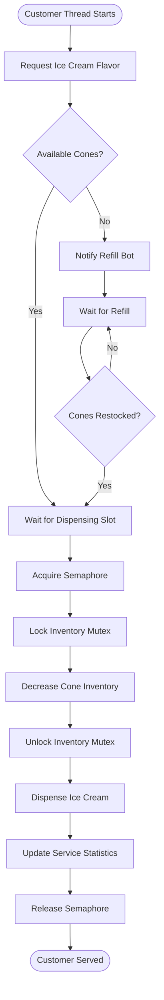

# Ice Cream Machine Simulator 🍦

A multithreaded simulation of a self-service ice cream machine that demonstrates concurrent programming concepts through customer threads, resource synchronization, and an autonomous refill system.

## Project Overview

The **Ice Cream Machine Simulator** was developed as part of the CSE325 course at East West University.

The project simulates the operations of a busy cafeteria where multiple customers compete for limited shared resources, including ice cream cones and flavor dispensers.

Using POSIX threads and synchronization primitives, the system coordinates customer activities, manages resource availability, prevents race conditions, and ensures efficient resource utilization.

## Simulation Scenario

The simulated cafeteria, *Frosty Delights*, offers five ice cream flavors:

- 🍫 Chocolate
- 🍦 Vanilla
- 🍓 Strawberry
- 🌿 Mint
- 🍯 Caramel

The machine operates under the following constraints:

| Resource | Configuration |
|---|---|
| Customers | 15 customer threads |
| Refill Bot | 1 background thread |
| Maximum Cone Inventory | 10 cones |
| Flavor Dispensers | 2 simultaneous slots |
| Refill Amount | 10 cones |
| Available Flavors | 5 |

## Features

### 1. Multithreaded Customer Simulation

- Creates 15 independent customer threads.
- Simulates randomized customer arrival times.
- Allows multiple customers to request resources concurrently.
- Assigns flavors to customers based on their IDs.
- Simulates ice cream dispensing with randomized service times.

### 2. Automated Refill System

- Implements a dedicated refill bot thread.
- Monitors cone inventory.
- Detects resource depletion.
- Automatically replenishes cones when necessary.
- Maintains the maximum inventory limit of 10 cones.
- Notifies waiting customers when cones become available.

### 3. Resource Management

- Manages a shared cone inventory.
- Controls access to two flavor dispensing slots.
- Prevents resource over-allocation.
- Maintains resource availability within defined limits.

### 4. Performance Monitoring

- Measures customer waiting time.
- Tracks the total number of customers served.
- Counts the number of refills.
- Monitors remaining cone inventory.
- Calculates average waiting time.

### 5. Thread-Safe Console Output

- Prevents interleaved console messages.
- Maintains readable simulation logs.
- Uses synchronization to protect shared output operations.

### 6. Graceful Termination

- Coordinates customer thread completion.
- Signals the refill bot when the simulation ends.
- Joins all created threads.
- Properly destroys synchronization resources.

## Concurrency and Synchronization

The project demonstrates several important concurrent programming concepts.

| Synchronization Primitive | Purpose |
|---|---|
| `pthread_mutex_t` | Protects shared cone inventory, statistics, and console output |
| `sem_t` | Controls simultaneous access to the two flavor dispensing slots |
| `pthread_cond_t` | Coordinates cone refill events and notifies waiting customers |

### Advanced Synchronization Techniques

- **Thread-Safe Randomization:** Uses `rand_r()` for per-thread random number generation.
- **Bounded Resource Management:** Ensures cone inventory never exceeds its maximum capacity.
- **Condition-Based Waiting:** Uses condition variables to avoid unnecessary busy-waiting.
- **Critical Section Protection:** Uses mutex locks to prevent race conditions.
- **Coordinated Shutdown:** Ensures proper thread termination and resource cleanup.

## System Architecture

The simulation consists of three primary components:

### 1. Customer Threads

- 15 independent threads representing customers.
- Request cones from the shared inventory.
- Wait for available flavor dispensing slots.
- Receive their assigned flavors.
- Update performance statistics.

### 2. Refill Bot Thread

- Runs in the background.
- Waits for resource depletion notifications.
- Refills the cone inventory.
- Broadcasts resource availability to waiting customers.

### 3. Main Orchestration Thread

- Initializes the machine and synchronization primitives.
- Creates and manages customer and refill threads.
- Coordinates simulation execution.
- Collects and displays final statistics.

## Customer Service Workflow

## Sample Simulation Output

The following results are from the project report's sample execution.

| Performance Metric | Result |
|---|---:|
| Total Customers Served | 15 |
| Total Refills | 1 |
| Final Cones Available | 5 |
| Average Wait for Cone | 0.00 ms |

The simulation successfully served all 15 customers and automatically refilled the cone inventory when it became depleted.

## Technology Stack

| Technology | Purpose |
|---|---|
| C | Core programming language |
| POSIX Threads (Pthreads) | Multithreaded execution |
| POSIX Semaphores | Resource access control |
| Mutexes | Shared resource protection |
| Condition Variables | Thread coordination |
| `time.h` | Timing and randomization |
| `unistd.h` | Sleep and timing operations |

## Learning Outcomes

Through this project, we gained practical experience in:

- POSIX thread creation, execution, and termination.
- Concurrent programming and thread lifecycle management.
- Mutexes, semaphores, and condition variables.
- Shared resource synchronization.
- Race condition prevention.
- Deadlock prevention through careful lock ordering.
- Thread-safe performance measurement.
- Graceful shutdown and resource cleanup.

---

**Developed as an academic project for CSE325, East West University.**
